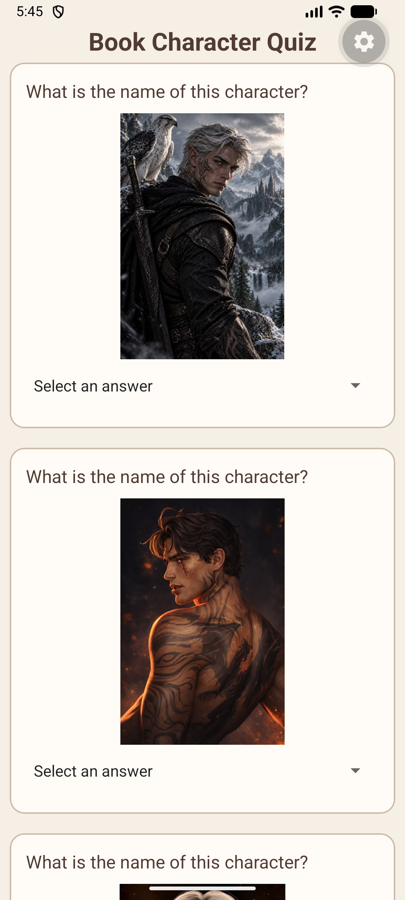
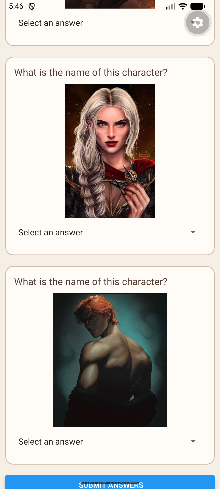
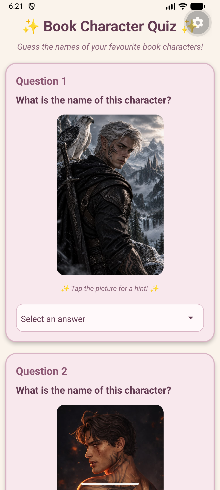
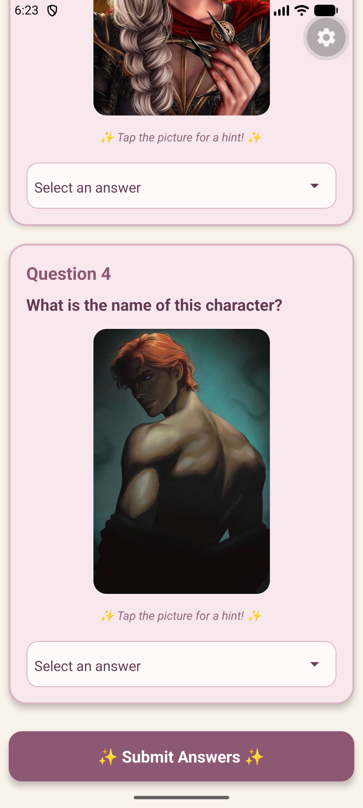
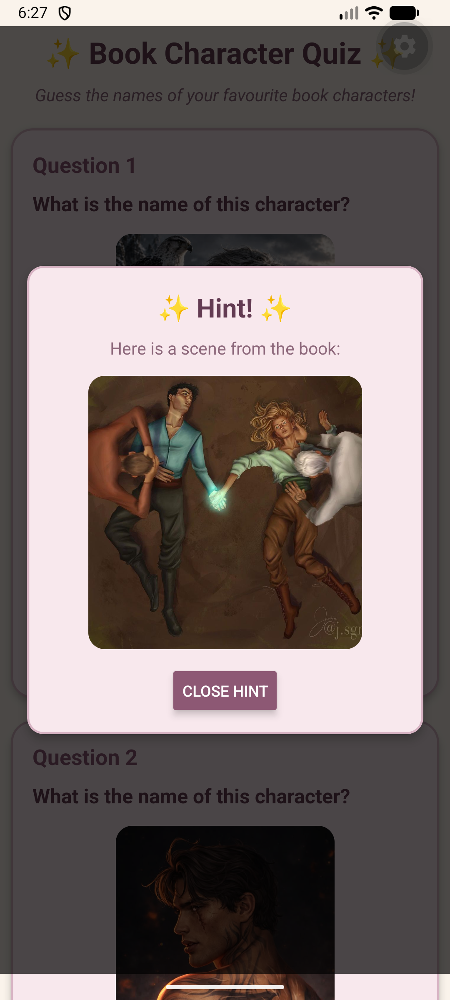

# App Name

Book Character Quiz is an interactive mobile application that allows users to test their knowledge of fictional characters from fantasy books. Users select the correct character names from a dropdown list and can tap on pictures to reveal hints. After completing the four questions, users can submit their answers to view their total score. The application aims to provide a fun and engaging experience for book lovers.

# ScreenShots of App BEFORE applying Stylesheet changes

Screenshots:  

# ScreenShots of App AFTER applying Stylesheet changes

Screenshots:  

 

# Link to Demo Video with audible narration explaining styling changes with code reference

Demo Video Link:  
[L08.mp4](../../Users/24047792/OneDrive%20-%20Republic%20Polytechnic/Documents/SCHOOL%20RP/Year%203%20Semester%202/C346%20Mobile%20App%20Development/Lesson%208/Submissions/L08.mp4)

